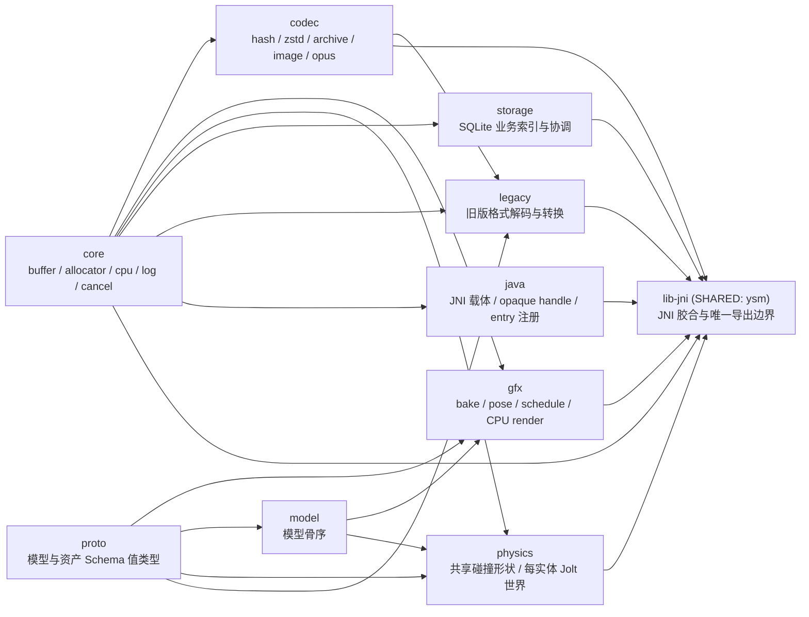

# 架构总览

## 模块依赖拓扑

所有生产模块均为静态库，最终仅由 `lib-jni` 聚合导出单一共享库 `ysm`。

第三方依赖通过 Conan 静态链接并收窄到最小消费 target。

## 平台与 ISA 基线

| target | ISA | OS / runtime |
| --- | --- | --- |
| Windows x86_64 | [`x86-64-v1`](https://clang.llvm.org/docs/UsersManual.html#x86) | Windows 7 SP1 |
| Linux x86_64 | [`x86-64-v1`](https://clang.llvm.org/docs/UsersManual.html#x86) | Linux 3.13.9 + glibc 2.19 |
| Android arm64 | `armv8-a` | Android API 28 |
| macOS arm64 | Apple M1（接近 `armv8.5-a`） | macOS 14.5 |

更高指令集（x64：`SSE41` / `AVX2` / `AVX512` 等；arm64：`SVE`）仅允许出现在带目标属性隔离的模板/函数实现中，启动时经 `InitCpuInfo()` 探测并写入 `simd::kSupported`，调用期经 `simd::Tag<Type>` 与 `EnumSwitch` 分派。

## 文档索引

- [开发指南](development_guide.md)
- [构建指南](build.md)
- [构建系统](build-system.md)
- [依赖管理](dependencies.md)
- [新平台适配](platform-porting.md)
