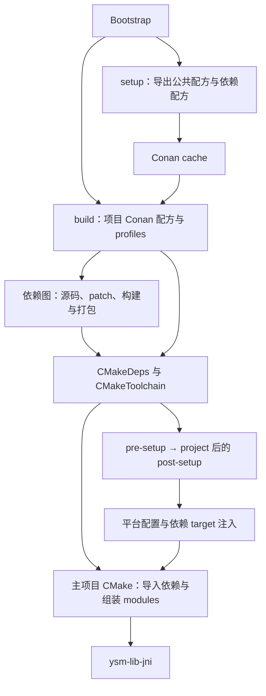

# Bootstrap、Conan 与 CMake 构建系统

本页记录当前构建系统的职责与配置流。日常构建命令及环境要求见[构建指南](build_cn.md)，依赖维护见[添加依赖与接入 mimalloc](dependencies_cn.md)。

## 设计目标

| 目标 | 设计取舍 |
| --- | --- |
| 简化构建流程，同时保持功能完备 | 用 bootstrap 收敛环境选择、配方导出与构建入口，用公共配方承载常规流程；保留 Conan 配方覆写、上游 CMake 选项与模块 target 接口，避免为了简化入口而丢失定制能力。 |
| 交叉编译友好，脱离系统环境 | 区分 host（目标）与 build（构建主机）上下文，显式选择编译器、链接器、SDK/sysroot 和 runtime，使目标产物不依赖主机偶然安装的头文件或库。工具链模式承担环境隔离，native 模式保留贡献者使用系统工具的入口。 |
| 降低系统环境漂移导致的问题 | 固定依赖来源与构建配置，用独立 Conan 缓存和构建修订号控制二进制复用，减少系统升级、PATH 顺序或预装依赖变化引入的不可解释差异。 |
| 统一依赖与项目代码的构建条件 | 所有目标侧依赖与项目代码使用相同工具链和共享构建参数，统一 runtime、标准库、ABI、异常/RTTI、PIC 与链接策略，最大程度降低 ABI 不匹配等疑难问题。包自身所需选项和经过隔离的 ISA 特化仍可不同；构建主机工具使用 build 上下文。 |
| 支持 Git patch 深度定制 | 将 mimalloc 接入、上游构建修正及不需要功能的裁剪随依赖配方导出，使从源码重建可重复应用同一组改动。升级依赖时必须重新核验 patch、分配器所有权与受影响平台，承担相应维护成本。 |

这些是设计目标，不等同于当前所有路径已经完全隔离或实现字节级可复现。native 模式仍依赖系统环境，Git tag 也不等同于不可变提交；实际缓存与源码选择行为见下文。新增平台的适配范围与验收见[非官方平台适配](platform-porting_cn.md)。

## 组织与职责

| 层 | 入口 | 职责 |
| --- | --- | --- |
| Bootstrap | `bootstrap.cmd` / `bootstrap.sh` | 选择 Conan 缓存、工具链与 host/build profile；导出配方，启动依赖安装或项目构建。 |
| 项目配方 | 根 `conanfile.py` | 声明直接依赖与测试依赖，生成主项目 CMake 配置，构建 `ysm-lib-jni`。 |
| 依赖配方 | `third-party/<name>/conanfile.py`、`conandata.yml` | 声明包身份、源码、patch、依赖、上游构建选项与导出的 CMake target。 |
| 公共配方 | `conan/base-recipe/conanfile.py` | 通过 `ysm_dependency_base/0.1@ysm/stable` 复用取源码、应用 patch、CMake 构建、打包与 target 元数据生成。特殊依赖可覆写对应阶段。 |
| 项目 profile | `conan/profile-override` | 叠加 C++ 标准、Ninja、项目构建修订号和 CMake hook。 |
| CMake hook | `conan/cmake/` | 为项目与依赖构建统一注入平台设置、编译/链接选项，以及配方声明的依赖 target。 |
| 主项目 CMake | 根 `CMakeLists.txt`、`third-party/import.cmake`、各 module | 导入并检查依赖 target，组织模块及其链接关系。 |

## Bootstrap 与 profile

- `setup` 先导出公共配方，再扫描 `third-party` 的直接子目录导出依赖配方，统一使用 `@ysm/stable`；它不编译依赖。
- `build <profile>` 默认执行 Release 的 `conan build`，由项目配方配置 CMake 并构建 `ysm-lib-jni`。`--debug` 切换 Debug；`--deps-only` 改为 `conan install`，成功生成主项目配置后才清理 Conan 依赖构建目录，不构建主项目。profile 探测、install 或清理失败均返回失败；install 失败时保留构建目录供排查。
- Conan 默认使用仓库内 `conan/cache`；`--cache` 显式覆盖 `CONAN_HOME`。`setup` 和 `build` 必须使用同一缓存。
- 构建使用 `--no-remote --build=missing`：配方由本地缓存提供，缺失的二进制包从源码构建。Git 源码下载仍可能需要网络。

| 模式 | Host profile：目标平台 | Build profile：运行构建工具的平台 |
| --- | --- | --- |
| 不传 `--toolchain`，仅允许 `native` | 自动探测的 `default` + `conan/profile-override` | `default` |
| 传 `--toolchain`，不允许 `native` | 工具链 `conan/<profile>` + `conan/profile-override` | 工具链内匹配构建主机的 profile；CMD 使用 `win-x64`，Shell 按 OS 选择。 |

工具链模式由工具链目录提供 Conan、CMake、Ninja 及平台 profiles；`native` 模式使用 PATH 中的工具。CMD 的 `native` 路径额外指定静态 compiler runtime。完整工具链版本与目标环境由[官方构建环境](official-build-environment_cn.md)维护。

主项目输出位于 `build/<profile>-<build-type>`，其中 build type 为小写；`generators` 子目录保存 Conan 生成的依赖配置、toolchain 与 presets。生成文件和 Conan cache 都是派生产物，配置变更应落在配方、profile 或 CMake 输入中。

## Conan 到 CMake 的配置流

普通依赖由公共配方读取 `conandata.yml`：取源码并按版本应用 patch，生成 `CMakeDeps` / `CMakeToolchain`，构建上游 CMake 工程，再安装或复制库与头文件。`package` 元数据决定消费者看到的包名、target、库和 include 目录。纯头文件包跳过 CMake 生成与构建，由 `manual_headers` 等配置打包。

项目 profile 将 `pre-setup.cmake` 加入 Conan toolchain 的 `user_toolchain`。它设置 CMake policy，并通过 `CMAKE_PROJECT_INCLUDE` 安排 `post-setup.cmake` 在 `project()` 后执行。后者设置通用选项、调用 `target-dispatch.cmake` 分派到 `targets/<os>-<arch>.cmake`，并完成依赖注入。

注入数据有两个来源：公共配方把直接 host 依赖的 CMake 包名写入 `YSM_REQUIRED_PACKAGES`，把 `build.global_link_targets` 写入 `YSM_GLOBAL_LINK_TARGETS`。Hook 先逐个 `find_package(... CONFIG REQUIRED)`，校验 target 存在，再用目录级 `link_libraries(...)` 应用于后续创建的 target。注入在该 CMake 配置进程内以全局属性防止重复执行，作用于正在构建的依赖工程，不会自动修改依赖源码。

主项目使用另一条显式接入路径：根配方生成 `YSM_DEPENDENCY_PROVIDER=conan`，根 CMake 校验该标记；`third-party/import.cmake` 中的 `ysm_import` 查找包并校验 target，消费模块再通过 `target_link_libraries` 链接。依赖包内部的全局注入与主项目的模块链接各自负责自己的构建边界。

## 缓存与变更传播

配方、`conandata.yml` 或导出的 patch 变化后重新执行 `setup`，再执行 `build`，使 Conan 使用新配方修订。当前 bootstrap 不显式创建或传入 lockfile；依赖版本在配方中声明，源码选择由各包的 `sources` 配置决定。

公共配方对非纯头文件包将 `user.ysm:rev` 和 `user.toolchain:rev` 纳入 package ID。修改共享 hook 或 profile 中影响二进制的设置时，应更新 `user.ysm:rev`；工具链变化由工具链修订号区分，避免 `--build=missing` 复用旧配置的包。纯头文件包清空 package ID 设置，不使用这两个修订号。

### 缓存裁剪

停止所有使用该缓存的构建后运行 `python conan/trim_cache.py --toolchain <toolchain>`；`--cache <path>` 选择其他缓存，`--dry-run` 仅预览。Conan 可执行文件和缓存版本都必须精确等于官方构建环境所用版本；不传 `--toolchain` 时使用 PATH Conan，也可用 `--conan <executable>` 指定。

`--ignore-conan-version` 强制跳过可执行文件和缓存版本检查；执行删除时所选 Conan 可能自动迁移缓存。预览不调用 Conan 删除命令。

裁剪按导入时间为每个 `name@user/channel` 保留最新 recipe，删除旧 version/revision；其二进制按 `(os, arch, build_type)` 分组，只保留打包时间最新的一份，设置为空的纯头文件包共用一个分组。旧 compiler、options、依赖和构建修订号不另设分组，需要时由后续构建重新生成。没有 recipe 记录或导出文件的包也会删除。

脚本只读扫描 Conan 缓存数据库，使用 Conan 删除清单执行裁剪，以覆盖普通 recipe 列表遗漏的孤立包。时间相同时按引用排序确定保留项；未完成的缓存记录或保留候选缺失二进制元数据时终止，不执行删除。
